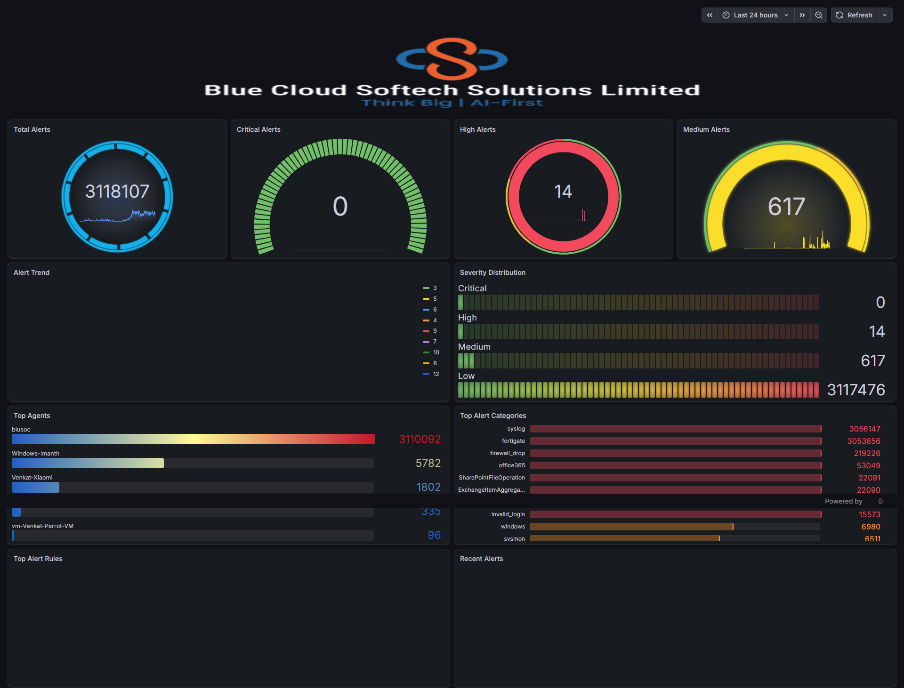
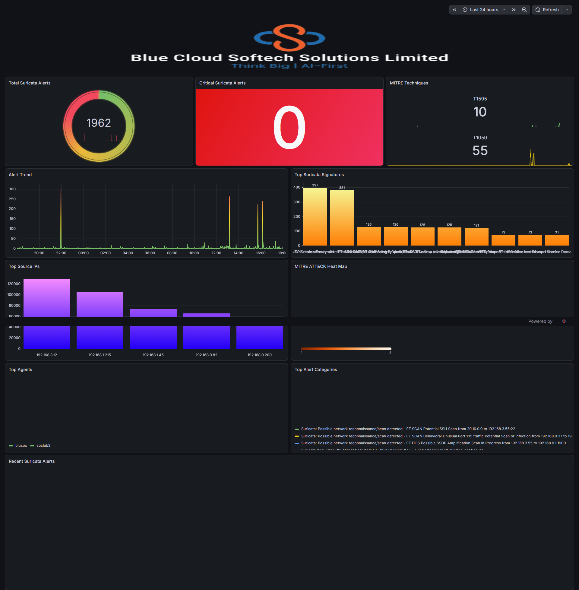
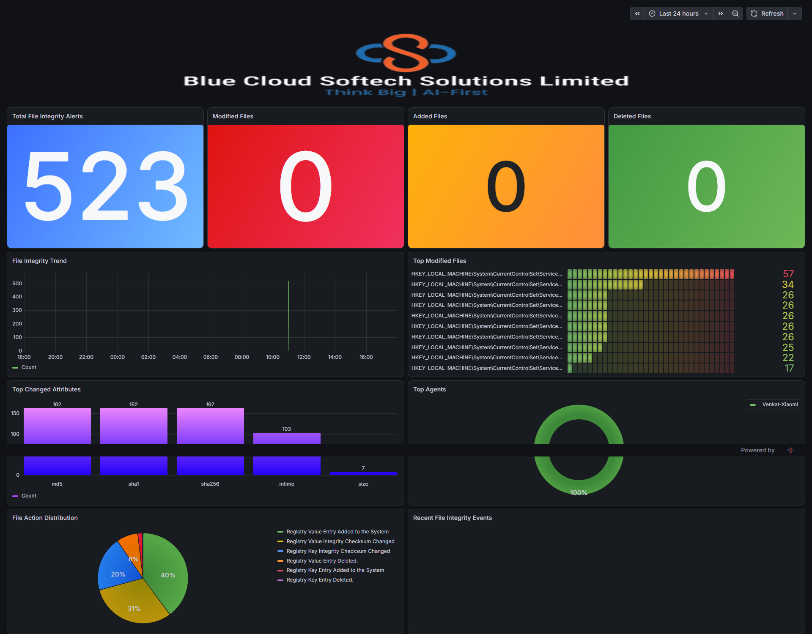
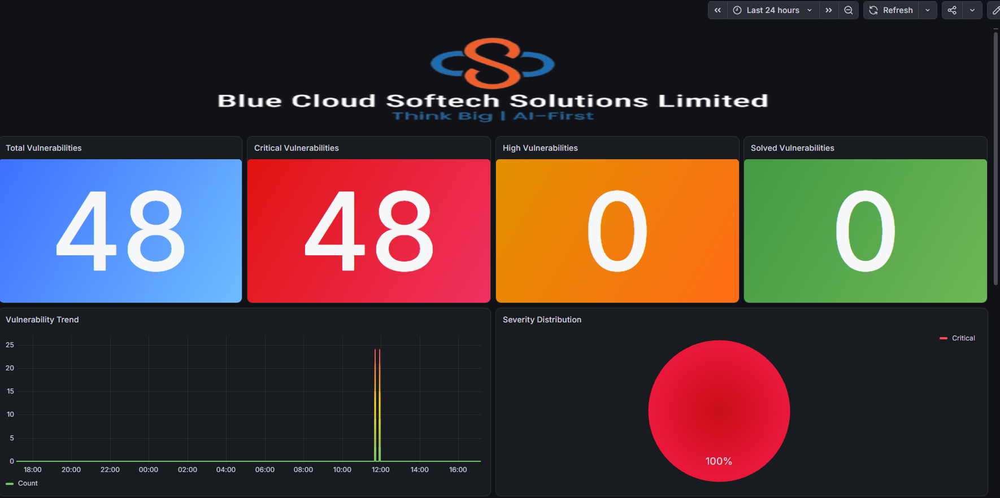
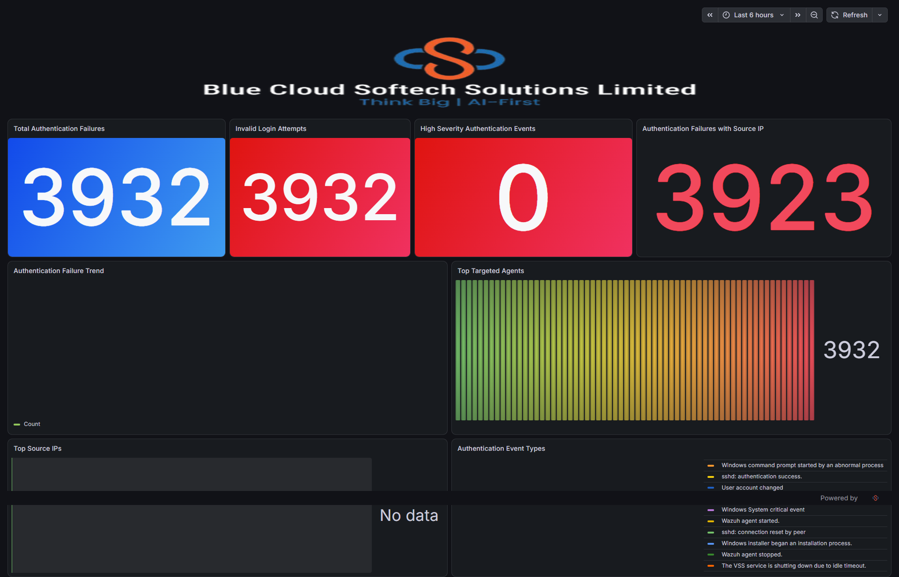
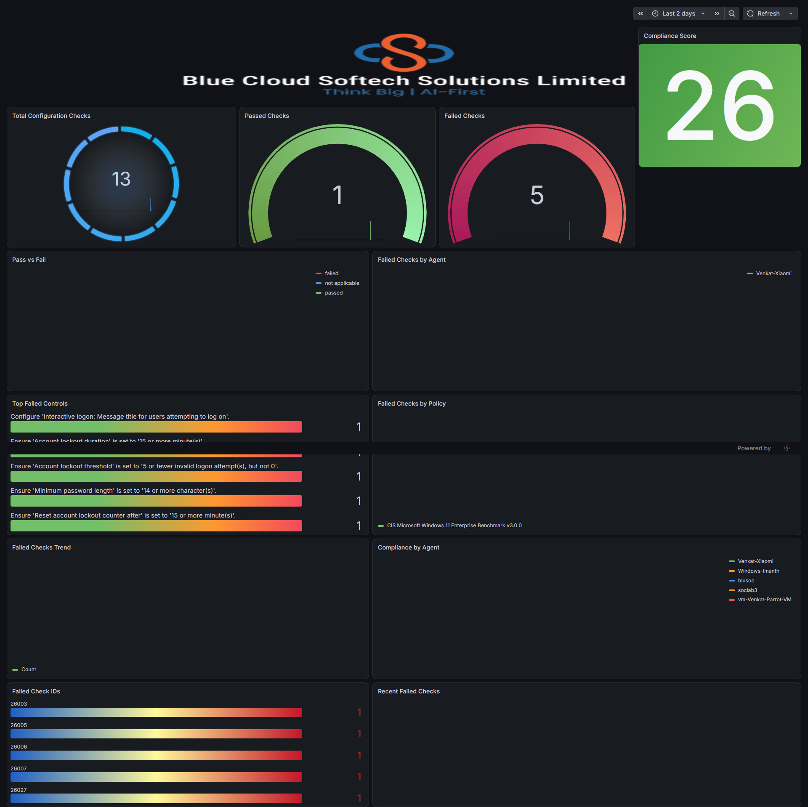

# Grafana SOC Detection Dashboards

Version-controlled export of the six purpose-built SOC dashboards for the Wazuh detection lab, plus the tooling and documentation to re-import them on a fresh Grafana.

|                     |                                                                                                |
| ------------------- | ---------------------------------------------------------------------------------------------- |
| **Source instance** | `http://192.168.3.55:3000` — Grafana **13.2.2**                                                |
| **TailScale**       | `http://100.126.218.97:3000`                                                                   |
| **Backing store**   | OpenSearch cluster `wazuh-cluster`, version **7.10.2** (Lucene 9.12.3)                         |
| **Data**            | `wazuh-alerts-4.x-YYYY.MM.DD` — 44 daily indices, **13,886,589** alerts, live as of 2026-11-10 |
| **Contents**        | 6 dashboards · 66 panels · 63 query targets · 20 OpenSearch fields                             |
| **Live validation** | **63/63 panel queries return data** (0 empty, 0 errors)                                        |
| **Last exported**   | 2026-11-10 (dashboards last edited in Grafana on 2026-10-01)                                   |

---

## The six dashboards

| Dashboard | Question it answers | UID |
|---|---|---|
| **SOC Overview** | How much is happening, and how bad is it? | `adgszzq` |
| **Threat Detection** | What is the network IDS telling us? (Suricata + MITRE ATT&CK) | `adsf5p4` |
| **File Integrity** | What changed on the endpoints? (FIM) | `ad65mdz` |
| **Vulnerabilities** | What is known-broken on the estate? | `ad4g2vm` |
| **Brute Force & Active Response** | Who is trying to get in, and did we respond? | `adl6mwj` |
| **Configuration Assessment** | Does the estate meet its security baseline? (CIS/SCA) | `adbz577` |

Full panel-by-panel detail: [`docs/DASHBOARD-CATALOG.md`](docs/DASHBOARD-CATALOG.md).

---

## Screenshots

Captured from the live instance by `scripts/capture-screenshots.js` (headless Chrome via playwright-core).

| SOC Overview | Threat Detection |
|---|---|
|  |  |

| File Integrity | Vulnerabilities |
|---|---|
|  |  |

| Brute Force & Active Response | Configuration Assessment |
|---|---|
|  |  |

> **A screenshot is rasterised telemetry.** Host names, source IPs and rule text are baked into the pixels and cannot be sanitised afterwards — unlike the JSON evidence, which `scripts/sanitize.js` can clean. That is why the screenshots are the one artefact in this repo that is *not* sanitised. Fine for a private internal repo; blur or drop them before publishing outside the organisation.

---

## Repository layout

```
grafana-soc-dashboards/
├── README.md                          # you are here
├── dashboards/                        # one Grafana-native JSON per dashboard
│   ├── ad4g2vm__vulnerabilities.json
│   ├── ad65mdz__file-integrity.json
│   ├── adbz577__configuration-assessment.json
│   ├── adgszzq__soc-overview.json
│   ├── adl6mwj__brute-force-and-active-response.json
│   └── adsf5p4__threat-detection.json
├── export/
│   ├── grafana-soc-dashboards.bundle.json   # single-file, importable bundle
│   ├── inventory.json                        # datasource + dashboard manifest
│   ├── audit-report.json                     # machine-readable audit
│   ├── panel-validation.json                 # live per-panel validation results
│   └── cluster-facts.json                    # cluster/data facts backing the audit
├── provisioning/                     # Grafana file-based provisioning
│   ├── datasources/datasources.yaml
│   └── dashboards/                   # provider.yaml + one dashboard file per dashboard
├── assets/
│   └── banner.png                    # branding image the header panels reference
├── docs/
│   ├── screenshots/                  # PNG capture of each dashboard (live telemetry - not sanitised)
│   ├── WORKSTREAM-AUDIT.md           # the in-depth audit against the workstream
│   ├── AUDIT-REPORT.md               # generated findings list
│   ├── PANEL-VALIDATION.md           # generated per-panel live data check
│   ├── DASHBOARD-CATALOG.md          # generated dashboard/panel catalogue
│   └── RE-IMPORT-GUIDE.md            # portability test procedure
├── .env.example                     # URL / username template - the password field is blank
├── .gitignore
├── scripts/
│   ├── export-dashboards.ps1         # live Grafana  -> repo
│   ├── import-dashboards.ps1         # repo          -> Grafana
│   ├── cluster-facts.js              # read-only cluster facts
│   ├── validate-queries.js           # read-only replay of every panel query (authoritative)
│   ├── validate-panels-grafana-api.js # same via Grafana's own query API (known divergence, see F1)
│   ├── sanitize.js                   # strips telemetry noise from the committed evidence
│   ├── redact-links.js               # re-points the hardcoded drill-down origin (F17)
│   ├── capture-screenshots.js        # headless Chrome capture of every dashboard
│   ├── audit-dashboards.js           # offline audit of the exported JSON
│   ├── build-catalog.js              # docs/DASHBOARD-CATALOG.md
│   ├── build-bundle.js               # export/grafana-soc-dashboards.bundle.json
│   └── build-provisioning.js         # provisioning/**
```

---

## Quick start

```powershell
# 1. export from the live instance (read-only)
$env:GRAFANA_URL='http://<grafana-host>:3000'
$env:GRAFANA_USER='<grafana-user>'; $env:GRAFANA_PASSWORD='<password>'
.\scripts\export-dashboards.ps1

# 2. audit + validate + regenerate the docs
node scripts\audit-dashboards.js
node scripts\validate-queries.js
node scripts\build-catalog.js
node scripts\build-bundle.js
node scripts\build-provisioning.js
node scripts\sanitize.js          # strip telemetry noise from the committed evidence
node scripts\capture-screenshots.js   # refresh docs/screenshots/ (optional, needs Chrome)

# 3. import into a fresh instance
.\scripts\import-dashboards.ps1 -GrafanaUrl 'http://<target>:3000' -FolderName 'SOC Detection Lab'
```

Credentials are read from the `GRAFANA_USER` / `GRAFANA_PASSWORD` environment variables — **never hard-code them, never commit them**. Copy `.env.example` to `.env` (git-ignored) if you prefer a file.

---

## Importing on a fresh Grafana

Three options, in order of preference:

1. **File provisioning** (fully automated, recommended) — copy `provisioning/` into the Grafana config folder. See [`docs/RE-IMPORT-GUIDE.md`](docs/RE-IMPORT-GUIDE.md) §1.
2. **UI import** — `Dashboards → New → Import → Upload JSON file` with `export/grafana-soc-dashboards.bundle.json`; Grafana asks which OpenSearch datasource to bind. §2.
3. **API import** — `scripts/import-dashboards.ps1`. §3.

Verify afterwards with `node scripts/validate-queries.js` — expect `{"data":63,"empty":0,"error":0}`.

---

## Security and data hygiene

**No credential is ever written to disk by any script in this repo.**

| | Where it lives | Committed? |
|---|---|---|
| Grafana password / API token | `GRAFANA_PASSWORD` env var (or your local `.env`) | ❌ never — `.env` is git-ignored, only `.env.example` (blank password) is committed |
| Grafana username | `GRAFANA_USER` env var | ❌ not hard-coded in any script |
| Grafana / OpenSearch URLs | `GRAFANA_URL` / `OSD_BASE_URL` env var | ✅ `.env.example` only — scripts default to `http://localhost:3000` and contain **no** internal addresses. This README deliberately lists the two reachable addresses of the lab (LAN + TailScale), since that is its purpose. |

Treated as *evidence* rather than as environment documentation, the telemetry is stripped from the committed artefacts by `scripts/sanitize.js`:

- internal source IPs → `<ip>` (the Grafana and OpenSearch hosts are deliberately kept — they are useful context in a private repo)
- agent / machine names → `<agent>`
- Windows SIDs → `<sid>`
- cluster UUID → `<cluster-uuid>`

The unsanitised originals are written to `export/raw/`, which is **git-ignored**, so the raw evidence stays on your machine without being published.

Two things are deliberately **not** sanitised, because they are import artefacts that must stay byte-faithful to the live dashboards:

- `dashboards/*.json` and `export/grafana-soc-dashboards.bundle.json` contain the hardcoded drill-down origin (finding **F17**) and the per-host colour overrides (finding **F18**).
- If you ever need to publish this repo outside the org, run `node scripts/redact-links.js --osd-base <url> --write` to re-point the 22 links, then rebuild the bundle and provisioning files.

---

## Current status and known issues

The audit found **no broken dashboards** — every panel query returns live data — but it did surface items that need action before the next rebuild:

| ID | Finding | Severity |
|---|---|---|
| **F1** | Datasource uses the legacy bracketed index pattern `[wazuh-alerts-4.x-]YYYY.MM.DD`; the plugin's backend path cannot resolve it, so headless/API validation returns empty frames | P1 |
| **F2** | Datasource declares OpenSearch `2.0.0` while the cluster is `7.10.2` | P1 |
| **F3** | Five unused datasources, two of them duplicates of the live one | P1 |
| **F4** | Header banner is a server-local asset (`/public/img/banner.png`) — image is versioned here, install step documented | P1 |
| **F5** | PPL is enabled on the datasource while every panel is authored in Lucene | P1 |
| **F6** | "Critical" gauges filter `rule.level >= 15`; the lab's highest level in 24h is 12, so they always read 0 | P2 |
| **F7** | Default windows are too narrow for low-volume rule groups (`sca` 13/24h, `vulnerability-detector` 48/24h) | P2 |
| **F8** | The MITRE heat map is scoped to Suricata only; the feed carries 26 techniques in 24h | P2 |
| **F9** | Two mislabelled panels on Threat Detection (`Top Source IPs` not Suricata-scoped, `Top Alert Categories` aggregates `rule.description`) | P2 |
| **F9b** | The MITRE ATT&CK Heat Map renders as an **empty grid** — its query returns 51 buckets and the stat panel beside it shows `T1595`/`T1059`, but with only 2 techniques in scope a heat map has nothing to draw | P2 |
| **F10** | Panels mix `timestamp` (event time) and `@timestamp` (ingest time) as the time axis | P2 |
| **F11** | No auto-refresh on any dashboard | P2 |
| **F17** | 22 drill-down links point at a hardcoded OpenSearch Dashboards origin (`https://192.168.1.210:20443/app/…`) — breaks on a rebuild and carries internal addressing inside the export | P1 |
| **F18** | 21 panels colour values by hardcoded host name — breaks silently if a host is renamed, and embeds estate hostnames in the export | P2 |
| **F12–F16** | No tags/folder, no Grafana alert rules, environment-specific datasource name, platform delta vs the workstream, SharePoint copy outstanding | P3 |

Full write-up, evidence and remediation: [`docs/WORKSTREAM-AUDIT.md`](docs/WORKSTREAM-AUDIT.md).

---

## Conventions

- One dashboard per operational question; the question is stated in [`docs/DASHBOARD-CATALOG.md`](docs/DASHBOARD-CATALOG.md).
- Queries are Lucene syntax against `wazuh-alerts-4.x-*`; the time field is `@timestamp`.
- Every change to a dashboard in the Grafana UI must be followed by `scripts/export-dashboards.ps1` and a commit — the repo, not the server, is the source of truth.
- Scripts are read-only except `import-dashboards.ps1`, which is explicitly opt-in and takes a target URL.
