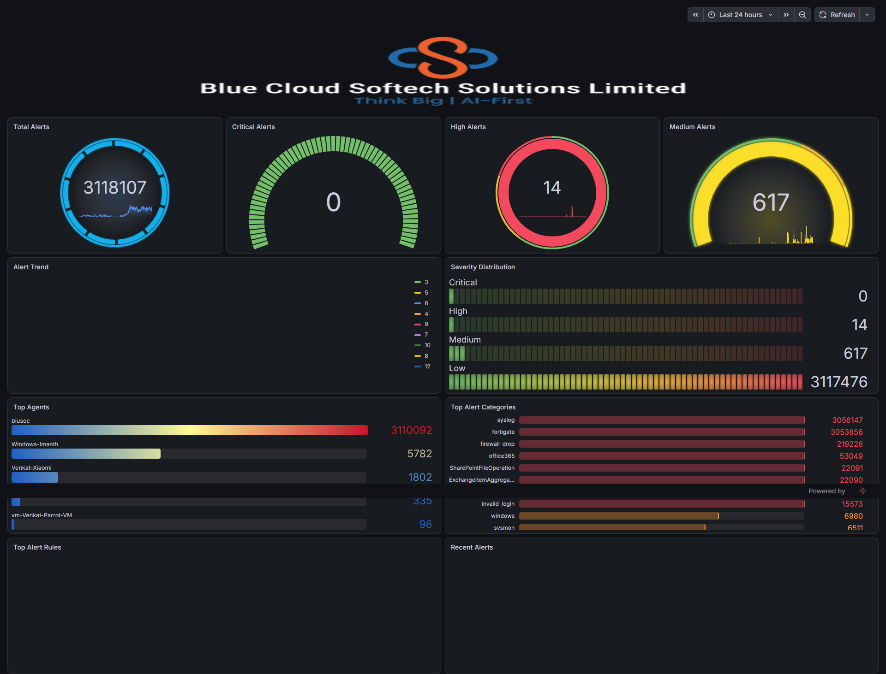
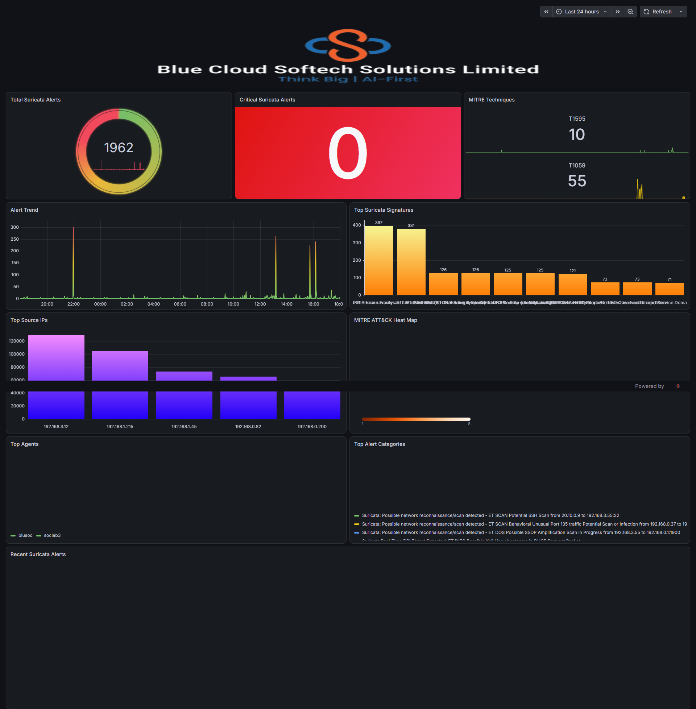
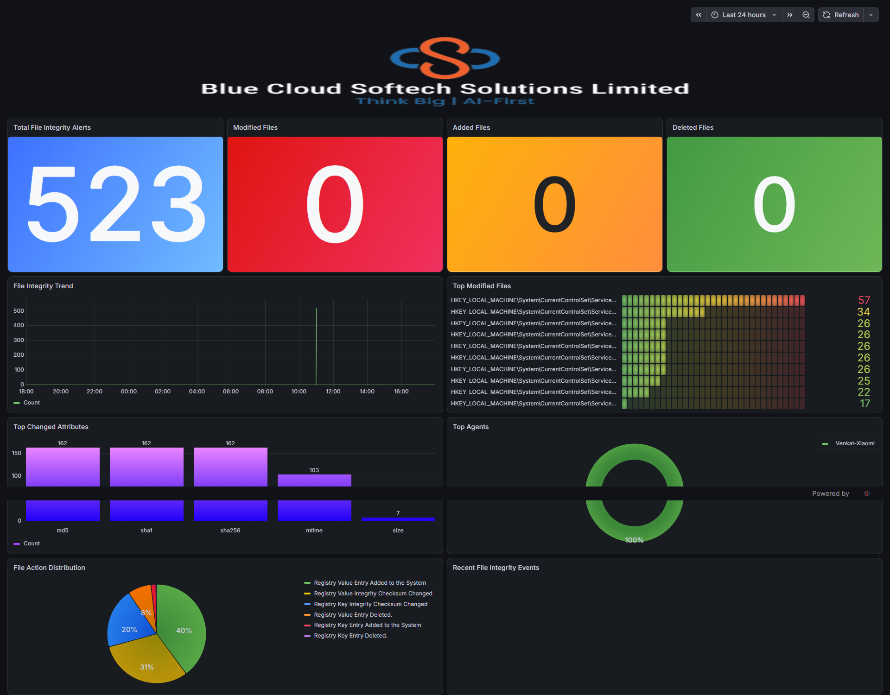
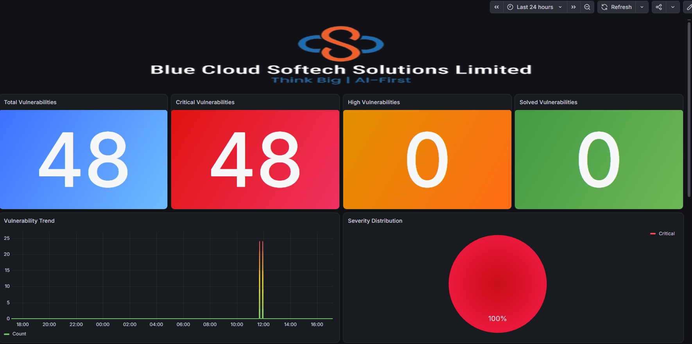
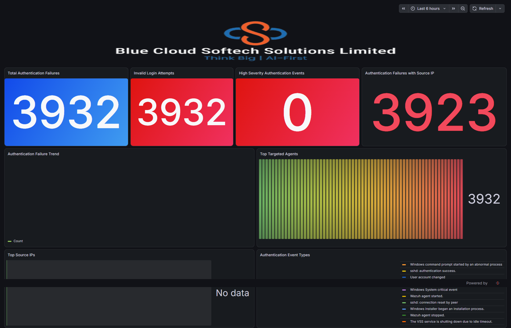
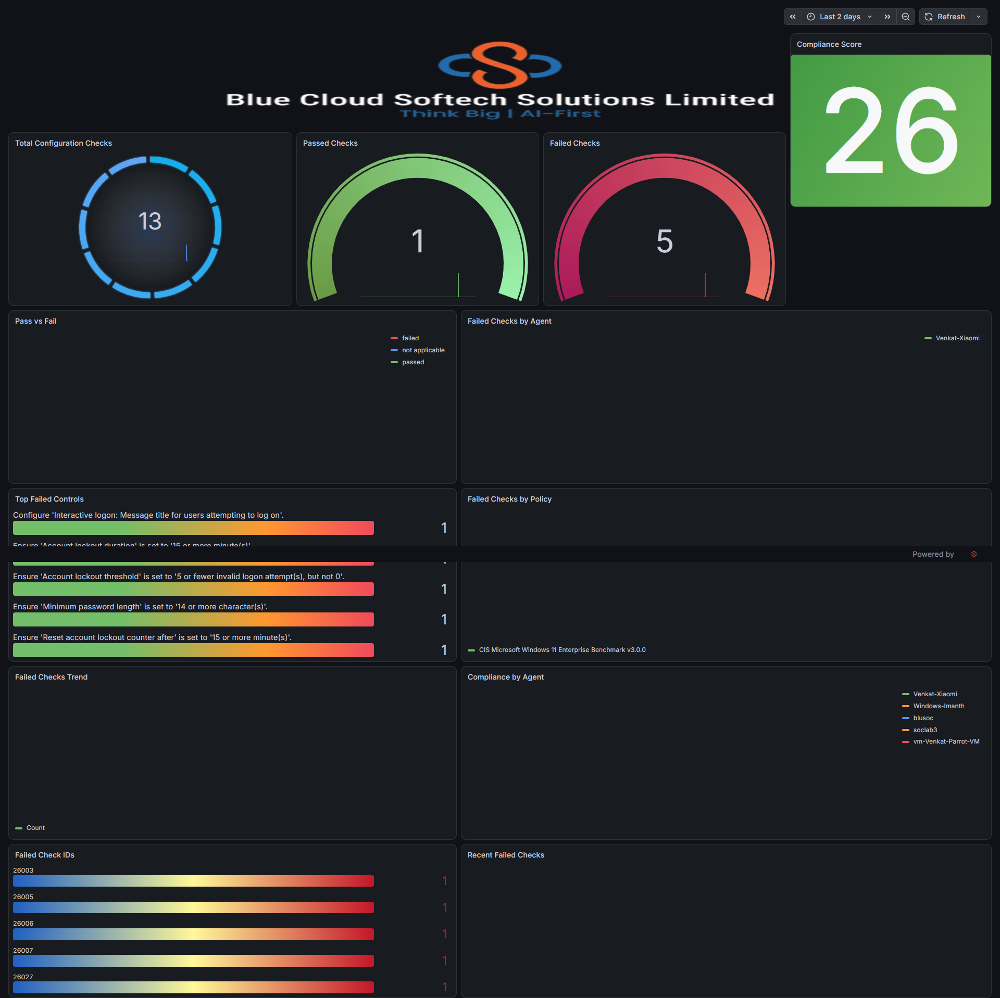

# Dashboard Catalog

Generated by `scripts/build-catalog.js` from the exported dashboard JSON + the live validation run.

> Screenshots are captured from the live instance by `scripts/capture-screenshots.js`. They contain live
> telemetry (host names, source IPs, rule text) - see the data-hygiene note in the README.

| # | Dashboard | Operational question it answers | UID | Panels | Default range | Live rows |
|---|---|---|---|---|---|---|
| 1 | **SOC Overview** | How much is happening, and how bad is it? (alert volume + severity) | `adgszzq` | 11 | now-24h → now | 1078 |
| 2 | **Threat Detection** | What is the network intrusion detection telling us? (Suricata + MITRE ATT&CK) | `adsf5p4` | 11 | now-24h → now | 394 |
| 3 | **File Integrity** | What changed on the endpoints? (FIM - modified / added / deleted files and registry keys) | `ad65mdz` | 11 | now-24h → now | 277 |
| 4 | **Vulnerabilities** | What is known-broken on the estate? (vulnerability detector alerts, severity, CVE, package) | `ad4g2vm` | 11 | now-24h → now | 456 |
| 5 | **Brute Force & Active Response** | Who is trying to get in, and did we respond? (authentication failures + active response) | `adl6mwj` | 9 | now-6h → now | 115 |
| 6 | **Configuration Assessment** | Does the estate meet its security baseline? (CIS / SCA check results) | `adbz577` | 13 | now-2d → now | 1092 |

---

## SOC Overview

- **UID:** `adgszzq`  |  **Grafana URL:** /d/adgszzq/soc-overview
- **Question:** How much is happening, and how bad is it? (alert volume + severity)
- **Default time range:** now-24h → now   |  **Auto-refresh:** none
- **Panels:** 11   |  **Last edited (server):** 2026-10-01T07:54:55Z
- **Datasource:** Blue Cloud Dashboard (index `[wazuh-alerts-4.x-]YYYY.MM.DD`)

| # | Panel | Type | Query | Aggregations | Fields used | Live rows |
|---|---|---|---|---|---|---|
| 11 | _(untitled)_ | text | _(branding banner)_ | — | — | — |
| 1 | Total Alerts | gauge | `*` | date_histogram: `timestamp` | `timestamp` | 49 |
| 2 | Critical Alerts | gauge | `rule.level:>=15` | date_histogram: `timestamp` | `timestamp` | 49 |
| 3 | High Alerts | gauge | `rule.level:[12 TO 14]` | date_histogram: `timestamp` | `timestamp` | 49 |
| 4 | Medium Alerts | gauge | `rule.level:[7 TO 11]` | date_histogram: `timestamp` | `timestamp` | 49 |
| 5 | Alert Trend | timeseries | `*` | terms: `rule.level` date_histogram: `@timestamp` | `rule.level`, `@timestamp` | 58 |
| 6 | Severity Distribution | bargauge | `rule.level:>=15` `rule.level:[12 TO 14]` `rule.level:[7 TO 11]` `rule.level:[0 TO 6]` | date_histogram: `@timestamp` date_histogram: `@timestamp` date_histogram: `@timestamp` date_histogram: `@timestamp` | `@timestamp` | 196 |
| 7 | Top Agents | bargauge | `*` | terms: `agent.name` date_histogram: `timestamp` | `agent.name`, `timestamp` | 54 |
| 8 | Top Alert Categories | bargauge | `*` | terms: `rule.groups` date_histogram: `timestamp` | `rule.groups`, `timestamp` | 59 |
| 9 | Top Alert Rules | table | `*` | terms: `rule.description` metric:rule.level | `rule.level`, `rule.description` | 15 |
| 10 | Recent Alerts | table | `*` | date_histogram: `@timestamp` | `@timestamp` | 500 |

## Threat Detection

- **UID:** `adsf5p4`  |  **Grafana URL:** /d/adsf5p4/threat-detection
- **Question:** What is the network intrusion detection telling us? (Suricata + MITRE ATT&CK)
- **Default time range:** now-24h → now   |  **Auto-refresh:** none
- **Panels:** 11   |  **Last edited (server):** 2026-10-01T07:54:55Z
- **Datasource:** Blue Cloud Dashboard (index `[wazuh-alerts-4.x-]YYYY.MM.DD`)

| # | Panel | Type | Query | Aggregations | Fields used | Live rows |
|---|---|---|---|---|---|---|
| 12 | _(untitled)_ | text | _(branding banner)_ | — | — | — |
| 1 | Total Suricata Alerts | gauge | `rule.groups:suricata` | date_histogram: `@timestamp` | `@timestamp` | 49 |
| 2 | Critical Suricata Alerts | stat | `rule.groups:suricata AND rule.level:[15 TO *]` | date_histogram: `@timestamp` | `@timestamp` | 49 |
| 3 | MITRE Techniques | stat | `rule.groups:suricata` | terms: `rule.mitre.id` date_histogram: `@timestamp` | `rule.mitre.id`, `@timestamp` | 51 |
| 4 | Alert Trend | timeseries | `rule.groups:suricata` | date_histogram: `@timestamp` | `@timestamp` | 49 |
| 5 | Top Suricata Signatures | barchart | `rule.groups:suricata` | terms: `rule.description` | `rule.description` | 10 |
| 7 | Top Source IPs | barchart | `*` | terms: `data.srcip` | `data.srcip` | 5 |
| 6 | MITRE ATT&CK Heat Map | heatmap | `rule.groups:suricata AND rule.mitre.id:*` | terms: `rule.mitre.id` date_histogram: `@timestamp` | `rule.mitre.id`, `@timestamp` | 51 |
| 8 | Top Agents | bargauge | `rule.groups:suricata` | terms: `agent.name` date_histogram: `@timestamp` | `agent.name`, `@timestamp` | 51 |
| 10 | Top Alert Categories | timeseries | `rule.groups:suricata` | terms: `rule.description` date_histogram: `@timestamp` | `rule.description`, `@timestamp` | 59 |
| 11 | Recent Suricata Alerts | table | `rule.groups:suricata` | date_histogram: `@timestamp` | `@timestamp` | 20 |

## File Integrity

- **UID:** `ad65mdz`  |  **Grafana URL:** /d/ad65mdz/file-integrity
- **Question:** What changed on the endpoints? (FIM - modified / added / deleted files and registry keys)
- **Default time range:** now-24h → now   |  **Auto-refresh:** none
- **Panels:** 11   |  **Last edited (server):** 2026-10-01T07:54:55Z
- **Datasource:** Blue Cloud Dashboard (index `[wazuh-alerts-4.x-]YYYY.MM.DD`)

| # | Panel | Type | Query | Aggregations | Fields used | Live rows |
|---|---|---|---|---|---|---|
| 11 | _(untitled)_ | text | _(branding banner)_ | — | — | — |
| 1 | Total File Integrity Alerts | stat | `rule.groups:syscheck` | date_histogram: `@timestamp` | `@timestamp` | 49 |
| 2 | Modified Files | stat | `rule.groups:syscheck AND rule.description:*modified*` | date_histogram: `@timestamp` | `@timestamp` | 49 |
| 3 | Added Files | stat | `rule.groups:syscheck AND rule.description:*added*` | date_histogram: `@timestamp` | `@timestamp` | 49 |
| 4 | Deleted Files | stat | `rule.groups:syscheck AND rule.description:*deleted*` | date_histogram: `@timestamp` | `@timestamp` | 49 |
| 5 | File Integrity Trend | timeseries | `rule.groups:syscheck` | date_histogram: `@timestamp` | `@timestamp` | 49 |
| 6 | Top Modified Files | bargauge | `rule.groups:syscheck` | terms: `syscheck.path` | `syscheck.path` | 10 |
| 7 | Top Changed Attributes | barchart | `rule.groups:syscheck` | terms: `syscheck.changed_attributes` | `syscheck.changed_attributes` | 5 |
| 8 | Top Agents | piechart | `rule.groups:syscheck` | terms: `agent.name` | `agent.name` | 1 |
| 9 | File Action Distribution | piechart | `rule.groups:syscheck` | terms: `rule.description` | `rule.description` | 6 |
| 10 | Recent File Integrity Events | table | `rule.groups:syscheck` | date_histogram: `@timestamp` | `@timestamp` | 10 |

## Vulnerabilities

- **UID:** `ad4g2vm`  |  **Grafana URL:** /d/ad4g2vm/vulnerabilities
- **Question:** What is known-broken on the estate? (vulnerability detector alerts, severity, CVE, package)
- **Default time range:** now-24h → now   |  **Auto-refresh:** none
- **Panels:** 11   |  **Last edited (server):** 2026-10-01T07:54:55Z
- **Datasource:** Blue Cloud Dashboard (index `[wazuh-alerts-4.x-]YYYY.MM.DD`)

| # | Panel | Type | Query | Aggregations | Fields used | Live rows |
|---|---|---|---|---|---|---|
| 12 | _(untitled)_ | text | _(branding banner)_ | — | — | — |
| 2 | Total Vulnerabilities | stat | `rule.groups:vulnerability-detector` | date_histogram: `@timestamp` | `@timestamp` | 49 |
| 3 | Critical Vulnerabilities | stat | `rule.groups:vulnerability-detector AND data.vulnerability.severity:Critical` | date_histogram: `@timestamp` | `@timestamp` | 49 |
| 4 | High Vulnerabilities | stat | `rule.groups:vulnerability-detector AND data.vulnerability.severity:High` | date_histogram: `@timestamp` | `@timestamp` | 49 |
| 5 | Solved Vulnerabilities | stat | `rule.groups:vulnerability-detector AND data.vulnerability.status:Solved` | date_histogram: `@timestamp` | `@timestamp` | 49 |
| 6 | Vulnerability Trend | timeseries | `rule.groups:vulnerability-detector` | date_histogram: `timestamp` | `timestamp` | 49 |
| 7 | Severity Distribution | piechart | `rule.groups:vulnerability-detector` | terms: `data.vulnerability.severity` date_histogram: `@timestamp` | `data.vulnerability.severity`, `@timestamp` | 50 |
| 8 | Top Affected Hosts | bargauge | `rule.groups:vulnerability-detector` | terms: `agent.name` date_histogram: `@timestamp` | `agent.name`, `@timestamp` | 51 |
| 9 | Top CVEs | bargauge | `rule.groups:vulnerability-detector` | terms: `data.vulnerability.cve` | `data.vulnerability.cve` | 10 |
| 10 | Vulnerable Packages | bargauge | `rule.groups:vulnerability-detector` | terms: `data.vulnerability.package.name` date_histogram: `@timestamp` | `data.vulnerability.package.name`, `@timestamp` | 50 |
| 11 | Package Architectures | piechart | `rule.groups:vulnerability-detector` | terms: `data.vulnerability.package.architecture` date_histogram: `@timestamp` | `data.vulnerability.package.architecture`, `@timestamp` | 50 |

## Brute Force & Active Response

- **UID:** `adl6mwj`  |  **Grafana URL:** /d/adl6mwj/brute-force-and-active-response
- **Question:** Who is trying to get in, and did we respond? (authentication failures + active response)
- **Default time range:** now-6h → now   |  **Auto-refresh:** none
- **Panels:** 9   |  **Last edited (server):** 2026-10-01T07:54:55Z
- **Datasource:** Blue Cloud Dashboard (index `[wazuh-alerts-4.x-]YYYY.MM.DD`)

| # | Panel | Type | Query | Aggregations | Fields used | Live rows |
|---|---|---|---|---|---|---|
| 9 | _(untitled)_ | text | _(branding banner)_ | — | — | — |
| 1 | Total Authentication Failures | stat | `rule.groups:authentication_failed` | date_histogram: `@timestamp` | `@timestamp` | 13 |
| 2 | Invalid Login Attempts | stat | `rule.groups:invalid_login` | date_histogram: `@timestamp` | `@timestamp` | 13 |
| 3 | High Severity Authentication Events | stat | `(rule.groups:authentication_failed OR rule.groups:invalid_login) AND rule.level >= 10` | date_histogram: `@timestamp` | `@timestamp` | 13 |
| 4 | Authentication Failures with Source IP | stat | `rule.groups:authentication_failed AND data.srcip:*` | date_histogram: `@timestamp` | `@timestamp` | 13 |
| 5 | Authentication Failure Trend | timeseries | `rule.groups:authentication_failed` | date_histogram: `@timestamp` | `@timestamp` | 13 |
| 6 | Top Targeted Agents | bargauge | `rule.groups:(authentication_failed OR invalid_login)` | terms: `agent.name` date_histogram: `@timestamp` | `agent.name`, `@timestamp` | 14 |
| 7 | Top Source IPs | bargauge | `(rule.groups:authentication_failed OR rule.groups:invalid_login)` | terms: `agent.ip` date_histogram: `@timestamp` | `agent.ip`, `@timestamp` | 13 |
| 8 | Authentication Event Types | piechart | `` | terms: `rule.description` date_histogram: `@timestamp` | `rule.description`, `@timestamp` | 23 |

## Configuration Assessment

- **UID:** `adbz577`  |  **Grafana URL:** /d/adbz577/configuration-assessment
- **Question:** Does the estate meet its security baseline? (CIS / SCA check results)
- **Default time range:** now-2d → now   |  **Auto-refresh:** none
- **Panels:** 13   |  **Last edited (server):** 2026-10-01T07:54:55Z
- **Datasource:** Blue Cloud Dashboard (index `[wazuh-alerts-4.x-]YYYY.MM.DD`)

| # | Panel | Type | Query | Aggregations | Fields used | Live rows |
|---|---|---|---|---|---|---|
| 13 | _(untitled)_ | text | _(branding banner)_ | — | — | — |
| 1 | Total Configuration Checks | gauge | `rule.groups:sca` | date_histogram: `@timestamp` | `@timestamp` | 97 |
| 2 | Passed Checks | gauge | `rule.groups:sca AND data.sca.check.result:passed` | date_histogram: `@timestamp` | `@timestamp` | 97 |
| 3 | Failed Checks | gauge | `rule.groups:sca AND data.sca.check.result:failed` | date_histogram: `@timestamp` | `@timestamp` | 97 |
| 4 | Compliance Score | stat | `rule.groups:sca AND data.sca.type:summary` | date_histogram: `@timestamp` metric:data.sca.score | `data.sca.score`, `@timestamp` | 97 |
| 5 | Pass vs Fail | piechart | `rule.groups:sca` | terms: `data.sca.check.result` date_histogram: `@timestamp` | `data.sca.check.result`, `@timestamp` | 100 |
| 6 | Failed Checks by Agent | bargauge | `rule.groups:sca AND data.sca.check.result:failed` | terms: `agent.name` date_histogram: `@timestamp` | `agent.name`, `@timestamp` | 98 |
| 8 | Top Failed Controls | bargauge | `rule.groups:sca AND data.sca.check.result:failed` | terms: `data.sca.check.title` date_histogram: `@timestamp` | `data.sca.check.title`, `@timestamp` | 102 |
| 7 | Failed Checks by Policy | timeseries | `rule.groups:sca AND data.sca.check.result:failed` | terms: `data.sca.policy` date_histogram: `@timestamp` | `data.sca.policy`, `@timestamp` | 98 |
| 9 | Failed Checks Trend | timeseries | `rule.groups:sca AND data.sca.check.result:failed` | date_histogram: `@timestamp` | `@timestamp` | 97 |
| 10 | Compliance by Agent | piechart | `` | terms: `agent.name` date_histogram: `@timestamp` metric:data.sca.score | `data.sca.score`, `agent.name`, `@timestamp` | 102 |
| 11 | Failed Check IDs | bargauge | `rule.groups:sca AND data.sca.check.result:failed` | terms: `data.sca.check.id` date_histogram: `@timestamp` | `data.sca.check.id`, `@timestamp` | 102 |
| 12 | Recent Failed Checks | table | `rule.groups:sca AND data.sca.check.result:failed` | date_histogram: `@timestamp` | `@timestamp` | 5 |

---

## Field reference

Every field referenced by these dashboards, and whether it exists in the live `wazuh-alerts-4.x-*` mapping.

| Field | Used by panels |
|---|---|
| `@timestamp` | SOC Overview → Alert Trend; SOC Overview → Severity Distribution; SOC Overview → Recent Alerts; Threat Detection → Total Suricata Alerts (+41 more) |
| `agent.ip` | Brute Force & Active Response → Top Source IPs |
| `agent.name` | SOC Overview → Top Agents; Threat Detection → Top Agents; File Integrity → Top Agents; Vulnerabilities → Top Affected Hosts (+3 more) |
| `data.sca.check.id` | Configuration Assessment → Failed Check IDs |
| `data.sca.check.result` | Configuration Assessment → Pass vs Fail |
| `data.sca.check.title` | Configuration Assessment → Top Failed Controls |
| `data.sca.policy` | Configuration Assessment → Failed Checks by Policy |
| `data.sca.score` | Configuration Assessment → Compliance Score; Configuration Assessment → Compliance by Agent |
| `data.srcip` | Threat Detection → Top Source IPs |
| `data.vulnerability.cve` | Vulnerabilities → Top CVEs |
| `data.vulnerability.package.architecture` | Vulnerabilities → Package Architectures |
| `data.vulnerability.package.name` | Vulnerabilities → Vulnerable Packages |
| `data.vulnerability.severity` | Vulnerabilities → Severity Distribution |
| `rule.description` | SOC Overview → Top Alert Rules; Threat Detection → Top Suricata Signatures; Threat Detection → Top Alert Categories; File Integrity → File Action Distribution (+1 more) |
| `rule.groups` | SOC Overview → Top Alert Categories |
| `rule.level` | SOC Overview → Alert Trend; SOC Overview → Top Alert Rules |
| `rule.mitre.id` | Threat Detection → MITRE Techniques; Threat Detection → MITRE ATT&CK Heat Map |
| `syscheck.changed_attributes` | File Integrity → Top Changed Attributes |
| `syscheck.path` | File Integrity → Top Modified Files |
| `timestamp` | SOC Overview → Total Alerts; SOC Overview → Critical Alerts; SOC Overview → High Alerts; SOC Overview → Medium Alerts (+3 more) |
